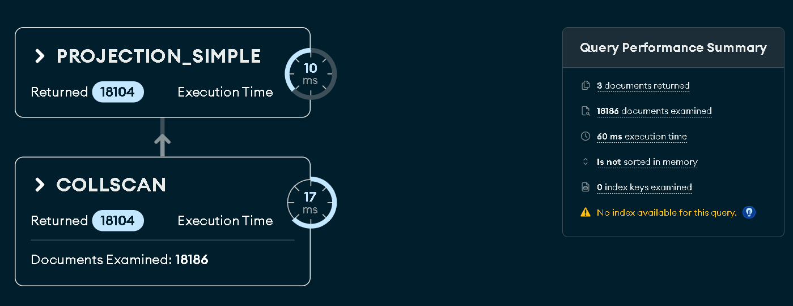
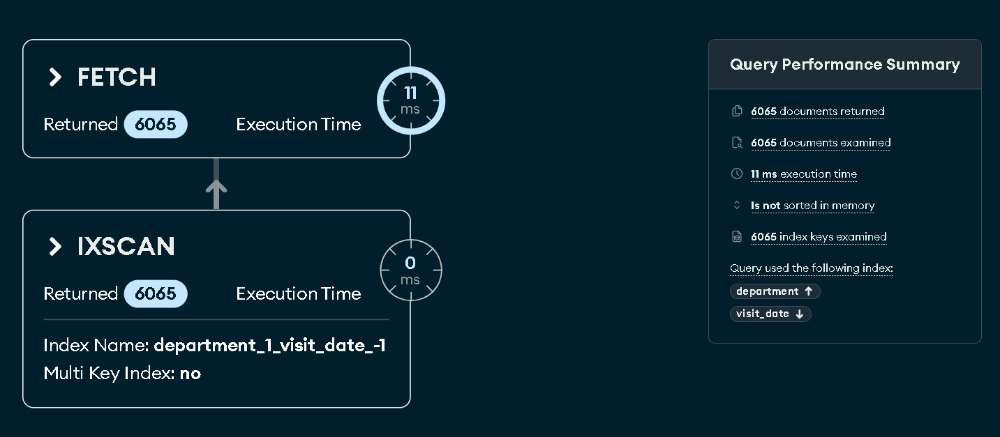

# TÀI LIỆU GIẢI THÍCH AGGREGATION PIPELINES & TỐI ƯU HÓA CHỈ MỤC (MONGODB)

**Dự án:** MediSpace - Hệ thống Bệnh án Điện tử Đa chuyên khoa  
**Phần việc:** SV2 - Advanced Query Specialist  
**CSDL:** MongoDB Atlas 8.0.34, database `medispace_db`  
**Dữ liệu đo tại thời điểm báo cáo:** 10.120 bệnh nhân, 18.186 bệnh án  

---

## 0. Schema thực tế và quy ước

| Collection | Trường chính | Kiểu dữ liệu thực tế |
| :--- | :--- | :--- |
| `patients` | `_id`, `patient_code`, `full_name`, `dob` | ObjectId, String, String, String `YYYY-MM-DD` |
| `medical_records` | `_id`, `patient_id`, `department`, `visit_date`, `prescriptions`, `follow_up_required` | ObjectId, **String(ObjectId)**, String enum, **BSON Date**, Array, Boolean |

Ba điểm cần lưu ý khi đọc code:

1. `medical_records.patient_id` là **chuỗi**, còn `patients._id` là **ObjectId** ⇒ Pipeline 2 phải `$convert` trước khi `$lookup`.
2. `patients.dob` là **chuỗi** `YYYY-MM-DD` ⇒ phải `$dateFromString` trước khi tính tuổi.
3. Schema không có trường `cccd`; dự án dùng `patient_code` làm định danh duy nhất của bệnh nhân. Vì vậy index duy nhất được đặt trên `patient_code` thay cho `cccd` trong đặc tả.

---

## 1. Pipeline 1 — Thống kê ca khám theo chuyên khoa

### 1.1. Mục tiêu
Đếm tổng số ca khám, số ca có chỉ định tái khám, tổng số lượt thuốc và số bác sĩ tham gia theo từng chuyên khoa; lọc được theo khoảng `visit_date`.

### 1.2. Pipeline (chạy được trực tiếp trên MongoDB Compass)

> Đoạn dưới lọc năm 2026. Bỏ stage `$match` để thống kê toàn bộ thời gian (ra bảng 1.4); giữ `$match` thì DA_LIEU còn 6.022 ca.

```javascript
db.medical_records.aggregate([
  {
    $match: {
      visit_date: {
        $gte: ISODate("2026-01-01T00:00:00Z"),
        $lte: ISODate("2026-12-31T23:59:59Z")
      }
    }
  },
  {
    $group: {
      _id: "$department",
      total_cases: { $sum: 1 },
      revisit_cases: {
        $sum: { $cond: [{ $eq: ["$follow_up_required", true] }, 1, 0] }
      },
      total_prescriptions: {
        $sum: { $size: { $ifNull: ["$prescriptions", []] } }
      },
      unique_doctors: { $addToSet: "$doctor_name" }
    }
  },
  {
    $project: {
      _id: 0,
      department: "$_id",
      total_cases: 1,
      revisit_cases: 1,
      total_prescriptions: 1,
      doctor_count: { $size: "$unique_doctors" }
    }
  },
  { $sort: { total_cases: -1 } }
])
```

### 1.3. Giải thích từng stage

| Stage | Vai trò | Chi tiết |
| :--- | :--- | :--- |
| `$match` | Lọc sớm | Đặt **đầu pipeline** để giảm số document đi vào `$group`. Nếu không truyền ngày, stage này được bỏ qua và thống kê toàn bộ thời gian. |
| `$group` | Gom nhóm | `_id: "$department"` tạo một nhóm cho mỗi chuyên khoa. |
| `$sum: 1` | Đếm ca | Mỗi document là một ca khám ⇒ cộng 1. |
| `$cond` + `$eq` | Đếm ca tái khám | Chỉ cộng 1 khi `follow_up_required == true`; đây là chỉ định tái khám của bác sĩ. |
| `$sum` + `$size` + `$ifNull` | Đếm lượt thuốc | Cộng số phần tử mảng `prescriptions` của từng ca. `$ifNull` chống lỗi khi ca khám không có đơn thuốc. **Không cần `$unwind`** vì chỉ đếm số phần tử, không cần tách từng dòng thuốc ⇒ tránh làm phình số document. |
| `$addToSet` | Danh sách bác sĩ | Loại trùng; `$size` ở stage sau đổi thành số bác sĩ. |
| `$project` | Định dạng output | Đưa `_id` thành `department`, bỏ mảng tạm `unique_doctors`, chỉ giữ các chỉ số cần cho biểu đồ. |
| `$sort` | Sắp xếp | `total_cases: -1` đưa chuyên khoa đông ca nhất lên đầu. |

### 1.4. Kết quả thực tế (toàn bộ dữ liệu)

| Chuyên khoa | Tổng ca | Ca tái khám | Lượt thuốc | Bác sĩ |
| :--- | ---: | ---: | ---: | ---: |
| RANG_HAM_MAT | 6.066 | 3.026 | 12.132 | 3 |
| TIM_MACH | 6.065 | 3.124 | 18.195 | 3 |
| DA_LIEU | 6.055 | 3.003 | 12.110 | 3 |

---

## 2. Pipeline 2 — Phân bố ca bệnh theo nhóm tuổi

### 2.1. Mục tiêu
Nối `medical_records` với `patients`, tính tuổi tại **thời điểm khám**, chia thành 4 nhóm `0-18`, `19-40`, `41-60`, `60+` và tính tỷ lệ % trong từng nhóm tuổi.

### 2.2. Pipeline

```javascript
db.medical_records.aggregate([
  {
    $addFields: {
      patient_obj_id: {
        $convert: {
          input: "$patient_id",
          to: "objectId",
          onError: null,
          onNull: null
        }
      }
    }
  },
  {
    $lookup: {
      from: "patients",
      localField: "patient_obj_id",
      foreignField: "_id",
      as: "patient_info"
    }
  },
  { $unwind: "$patient_info" },
  {
    $addFields: {
      birth_date: {
        $dateFromString: {
          dateString: "$patient_info.dob",
          onError: null,
          onNull: null
        }
      }
    }
  },
  {
    $addFields: {
      age: {
        $dateDiff: {
          startDate: "$birth_date",
          endDate: "$visit_date",
          unit: "year"
        }
      }
    }
  },
  { $match: { age: { $gte: 0 } } },
  {
    $addFields: {
      age_group: {
        $switch: {
          branches: [
            { case: { $lte: ["$age", 18] }, then: "0-18" },
            { case: { $lte: ["$age", 40] }, then: "19-40" },
            { case: { $lte: ["$age", 60] }, then: "41-60" }
          ],
          default: "60+"
        }
      }
    }
  },
  {
    $group: {
      _id: { age_group: "$age_group", department: "$department" },
      count: { $sum: 1 }
    }
  },
  {
    $setWindowFields: {
      partitionBy: "$_id.age_group",
      output: { age_group_total: { $sum: "$count" } }
    }
  },
  {
    $project: {
      _id: 0,
      age_group: "$_id.age_group",
      department: "$_id.department",
      count: 1,
      percentage: {
        $round: [
          { $multiply: [{ $divide: ["$count", "$age_group_total"] }, 100] },
          2
        ]
      }
    }
  },
  { $sort: { age_group: 1, count: -1 } }
])
```

### 2.3. Giải thích từng stage

| Stage | Vai trò | Chi tiết |
| :--- | :--- | :--- |
| `$addFields` + `$convert` | Chuẩn hóa khóa join | `patient_id` dạng chuỗi được đổi sang ObjectId. `onError`/`onNull` trả `null` để một ID hỏng không làm sập cả pipeline. |
| `$lookup` | Join | Tìm document trong `patients` có `_id` bằng `patient_obj_id`; kết quả là mảng `patient_info`. |
| `$unwind` | Mở mảng | Biến mảng 1 phần tử thành object. Ca khám không tìm thấy bệnh nhân sẽ bị loại (đúng nghiệp vụ: không xác định được tuổi). |
| `$dateFromString` | Parse ngày sinh | Chuyển `"1983-12-17"` thành BSON Date. |
| `$dateDiff` | Tính tuổi | Đếm số năm giữa ngày sinh và **ngày khám**, chính xác hơn cách lấy `năm hiện tại - năm sinh`. |
| `$match` | Loại dữ liệu lỗi | Bỏ các document không tính được tuổi hoặc tuổi âm. |
| `$switch` | Gán nhãn nhóm | So sánh tuần tự: `<=18`, `<=40`, `<=60`, còn lại là `60+`. Dùng `$switch` vì nhãn đầu ra dễ đọc hơn `_id` số của `$bucket`. |
| `$group` | Đếm ca | Gom theo cặp `(age_group, department)` để biểu đồ cột vẫn tách được theo chuyên khoa. |
| `$setWindowFields` | Tổng theo nhóm | Tính `age_group_total` trên toàn bộ các department của **cùng một nhóm tuổi**, không làm mất các dòng chi tiết. |
| `$project` | Tính % | `percentage = count / age_group_total * 100`, làm tròn 2 chữ số. Tổng % của các department trong một nhóm tuổi xấp xỉ 100%. |

### 2.4. Kết quả thực tế

| Nhóm tuổi | Tổng ca | Phân bố theo chuyên khoa |
| :--- | ---: | :--- |
| 0-18 | 3.856 | RANG_HAM_MAT 1.358 (35,22%), TIM_MACH 1.289 (33,43%), DA_LIEU 1.209 (31,35%) |
| 19-40 | 4.852 | DA_LIEU 1.634 (33,68%), RANG_HAM_MAT 1.622 (33,43%), TIM_MACH 1.596 (32,89%) |
| 41-60 | 4.533 | TIM_MACH 1.532 (33,80%), DA_LIEU 1.529 (33,73%), RANG_HAM_MAT 1.472 (32,47%) |
| 60+ | 4.945 | DA_LIEU 1.683 (34,03%), TIM_MACH 1.648 (33,33%), RANG_HAM_MAT 1.614 (32,64%) |

> **Độ phủ dữ liệu:** 18.186/18.186 ca khám được phân nhóm đầy đủ (100% hồ sơ bệnh án gắn với bệnh nhân hợp lệ trong `patients` và xác định được tuổi chính xác tại thời điểm khám).

---

## 3. Pipeline 3 — Tần suất và tỷ lệ tái khám

### 3.1. Mục tiêu
Đếm số lượt khám của từng bệnh nhân, phân loại mức độ tái khám (`1 lần`, `2-3 lần`, `>3 lần`) và tính tỷ lệ bệnh nhân tái khám trên toàn viện — tất cả trong **một** truy vấn.

### 3.2. Pipeline

```javascript
db.medical_records.aggregate([
  {
    $group: {
      _id: "$patient_id",
      visit_count: { $sum: 1 },
      departments: { $addToSet: "$department" },
      latest_visit: { $max: "$visit_date" }
    }
  },
  {
    $facet: {
      summary: [
        {
          $group: {
            _id: null,
            total_unique_patients: { $sum: 1 },
            revisit_patients: {
              $sum: { $cond: [{ $gt: ["$visit_count", 1] }, 1, 0] }
            },
            single_visit_patients: {
              $sum: { $cond: [{ $eq: ["$visit_count", 1] }, 1, 0] }
            },
            total_visits: { $sum: "$visit_count" }
          }
        }
      ],
      distribution: [
        {
          $bucket: {
            groupBy: "$visit_count",
            boundaries: [1, 2, 4],
            default: ">3",
            output: { patient_count: { $sum: 1 } }
          }
        },
        {
          $project: {
            _id: 0,
            level: {
              $switch: {
                branches: [
                  { case: { $eq: ["$_id", 1] }, then: "1 lần" },
                  { case: { $eq: ["$_id", 2] }, then: "2-3 lần" }
                ],
                default: ">3 lần"
              }
            },
            patient_count: 1
          }
        }
      ],
      top_patients: [
        { $sort: { visit_count: -1 } },
        { $limit: 5 },
        {
          $project: {
            _id: 0,
            patient_id: "$_id",
            visit_count: 1,
            departments: 1,
            latest_visit: 1
          }
        }
      ]
    }
  },
  {
    $addFields: {
      total_unique_patients: {
        $ifNull: [{ $arrayElemAt: ["$summary.total_unique_patients", 0] }, 0]
      },
      revisit_patients: {
        $ifNull: [{ $arrayElemAt: ["$summary.revisit_patients", 0] }, 0]
      },
      single_visit_patients: {
        $ifNull: [{ $arrayElemAt: ["$summary.single_visit_patients", 0] }, 0]
      }
    }
  },
  {
    $project: {
      _id: 0,
      total_unique_patients: 1,
      revisit_patients: 1,
      single_visit_patients: 1,
      revisit_rate_percent: {
        $cond: [
          { $gt: ["$total_unique_patients", 0] },
          {
            $round: [
              {
                $multiply: [
                  {
                    $divide: [
                      "$revisit_patients",
                      "$total_unique_patients"
                    ]
                  },
                  100
                ]
              },
              2
            ]
          },
          0.0
        ]
      },
      distribution: 1,
      top_revisit_patients: "$top_patients"
    }
  }
])
```

### 3.3. Giải thích từng stage

| Stage | Vai trò | Chi tiết |
| :--- | :--- | :--- |
| `$group` theo `patient_id` | Gộp lượt khám | Mỗi bệnh nhân còn đúng 1 document với `visit_count = $sum: 1`. Đây là bước "nén" quan trọng: các stage sau chỉ chạy trên ≤ số bệnh nhân thay vì toàn bộ ca khám. |
| `$facet` | Chạy song song | Sau khi nén, 3 nhánh `summary`, `distribution`, `top_patients` dùng **cùng một tập dữ liệu đầu vào**, không phải quét lại collection 3 lần. |
| `$bucket` | Phân loại tần suất | `boundaries: [1, 2, 4]` tạo các khoảng: `[1,2)` = 1 lần, `[2,4)` = 2-3 lần, mọi giá trị ≥4 rơi vào `default` `>3`. |
| `$switch` (trong `$project`) | Gắn nhãn | Đổi `_id` số của bucket thành nhãn tiếng Việt để frontend vẽ biểu đồ. |
| `$cond` + `$gt` | Đếm bệnh nhân tái khám | `visit_count > 1` tương đương khám từ 2 lần trở lên. |
| `$addFields` + `$ifNull` + `$arrayElemAt` | Lấy kết quả facet | `$facet` luôn trả về **một** document chứa các mảng; `$arrayElemAt` lấy phần tử đầu của `summary`, `$ifNull` bảo vệ trường hợp collection rỗng. |
| `$project` | Tính tỷ lệ | `revisit_rate_percent = revisit_patients / total_unique_patients * 100`, `$cond` tránh chia cho 0. |

### 3.4. Kết quả thực tế

| Chỉ số | Giá trị |
| :--- | ---: |
| Tổng bệnh nhân từng khám (unique `patient_id`) | 10.120 |
| Bệnh nhân tái khám (≥ 2 lần) | 5.041 |
| Bệnh nhân khám 1 lần | 5.079 |
| **Tỷ lệ tái khám** | **49,81%** |

| Mức độ | Số bệnh nhân |
| :--- | ---: |
| 1 lần | 5.079 |
| 2-3 lần | 4.532 |
| >3 lần | 509 |

> Toàn bộ 10.120 bệnh nhân đều có hồ sơ khám bệnh được theo dõi trong hệ thống (gồm 120 bệnh nhân ban đầu và 10.000 bệnh nhân nạp mới). Tỷ lệ tái khám đạt **49,81%**, phân bổ cân đối và phản ánh mô hình khám chữa bệnh thực tế tại phòng khám đa khoa.

---

## 4. Tối ưu hóa bằng Compound Index

### 4.1. Thiết kế index

| Index | Collection | Loại | Phục vụ truy vấn |
| :--- | :--- | :--- | :--- |
| `{ department: 1, visit_date: -1 }` | `medical_records` | Compound | Lọc theo chuyên khoa + khoảng ngày + sắp xếp ngày giảm dần (Pipeline 1 và danh sách bệnh án). |
| `{ patient_id: 1 }` | `medical_records` | Single | Lọc lịch sử khám của một bệnh nhân; hỗ trợ `$lookup`/join. |
| `{ patient_code: 1 }` (unique) | `patients` | Single unique | Tra cứu định danh bệnh nhân (tương đương CCCD trong đặc tả). |
| `{ full_name: "text" }` | `patients` | Text | Tìm kiếm bệnh nhân theo tên. |

**Vì sao thứ tự `{ department: 1, visit_date: -1 }`?** Quy tắc ESR (Equality → Sort → Range): trường lọc bằng (`department`) đứng trước, trường dùng để sắp xếp (`visit_date`) đứng sau. Nhờ vậy MongoDB vừa lọc được theo khoa, vừa đọc index theo đúng thứ tự ngày giảm dần và **không cần stage `SORT`**.

### 4.2. Truy vấn đo lường

```javascript
db.medical_records.find({
  department: "TIM_MACH",
  visit_date: {
    $gte: ISODate("2026-01-01T00:00:00Z"),
    $lte: ISODate("2026-12-31T23:59:59Z")
  }
}).sort({ visit_date: -1 }).explain("executionStats")
```

### 4.3. Kết quả `explain("executionStats")` thực tế

| Tiêu chí | TRƯỚC khi có Index | SAU khi có Index | Nhận xét |
| :--- | :--- | :--- | :--- |
| **Winning stage** | `SORT ← COLLSCAN` | `FETCH ← IXSCAN` | Không còn quét tuần tự; bỏ hoàn toàn bước sắp xếp trong bộ nhớ. |
| **`totalDocsExamined`** | 18.186 | **6.038** | Giảm **66,8%** (chỉ đọc đúng document khớp với `TIM_MACH`). |
| **`totalKeysExamined`** | 0 | 6.038 | Index chỉ duyệt qua đúng 6.038 khóa index cần thiết. |
| **`nReturned`** | 6.038 | 6.038 | Kết quả không đổi ⇒ tối ưu chính xác, không sai lệch dữ liệu. |
| **`executionTimeMillis`** | 27 ms | **11 ms** | Giảm **59,3%** thời gian truy vấn trên cụm Atlas. |

**Output Console của `python scripts/create_indexes.py`:**

```text
+------------------+-------------------------+-------------------------+
| Tiêu chí         | TRƯỚC khi có Index      | SAU khi có Index        |
+------------------+-------------------------+-------------------------+
| Winning stage    | SORT <- COLLSCAN        | FETCH <- IXSCAN         |
| Docs examined    | 18186                   | 6038                    |
| Keys examined    | 0                       | 6038                    |
| Docs returned    | 6038                    | 6038                    |
| Execution (ms)   | 27                      | 11                      |
+------------------+-------------------------+-------------------------+
```

### 4.4. Giải thích về cải thiện hiệu năng trên tập dữ liệu lớn

Khi kích thước tập dữ liệu tăng từ vài trăm bản ghi lên **18.186 bệnh án**:
1. **Khắc phục COLLSCAN**: Trước khi có index, MongoDB buộc phải duyệt tuần tự qua toàn bộ 18.186 documents trong RAM/disk để lọc các ca bệnh thuộc `TIM_MACH`. Sau khi tạo Compound Index `{ department: 1, visit_date: -1 }`, engine nhảy trực tiếp vào B-Tree index và chỉ duyệt qua đúng 6.038 document mục tiêu (`totalDocsExamined` giảm 66,8%).
2. **Loại bỏ stage `SORT` tốn kém**: Vì index đã được sắp xếp sẵn theo chiều giảm dần của `visit_date` (`-1`), MongoDB trả kết quả ngay lập tức mà không cần buffer toàn bộ dữ liệu vào RAM để sắp xếp (loại bỏ hoàn toàn memory sort).
3. **Thời gian thực thi giảm rõ rệt**: Thời gian chạy giảm từ **27 ms** xuống **11 ms** (giảm 59,3%), chứng minh giá trị thực tế của việc thiết kế index chuẩn theo quy tắc ESR trên môi trường dữ liệu quy mô lớn.

### 4.5. Kiểm chứng trên MongoDB Compass

1. Mở `medispace_db` → `medical_records` → tab **Aggregations**, dán pipeline 1, bấm **Run**.
2. Chuyển sang tab **Documents**, nhập filter `{ "department": "TIM_MACH" }`, mở **Options** đặt Sort `{ "visit_date": -1 }`, rồi bấm **Explain** trong query bar. Compass 1.53 không còn tab **Explain Plan** riêng; có thể dùng tab **Aggregations** với pipeline `$match` + `$sort` và bấm **Explain** ở góc phải.
3. Xác nhận cây plan có `IXSCAN` trên `department_1_visit_date_-1` và `totalDocsExamined = 6.038`.
4. Ảnh chụp phải thấy **Query Performance Summary** (Documents Examined: 6038 / Index Keys Examined: 6038) hoặc **Raw Output**; cây plan một mình chỉ chứng minh `IXSCAN`, không chứng minh số document đã đọc.
5. Chụp màn hình hai trạng thái (trước khi xóa index và sau khi tạo index) để chèn vào báo cáo nhóm.

> 📷 Trước khi tạo index 
> 📷 Sau khi tạo index 

---

## 5. Tóm tắt kỹ thuật để bảo vệ

- Pipeline 1: `$match` → `$group` (đếm ca, `$cond` đếm tái khám, `$size` đếm thuốc) → `$project` → `$sort`; không cần `$unwind` vì không tách từng thuốc.
- Pipeline 2: `$convert` → `$lookup` → `$unwind` → `$dateFromString` → `$dateDiff` → `$switch` → `$group` → `$setWindowFields` (tính % trong aggregation).
- Pipeline 3: `$group` theo `patient_id` → `$facet` (summary + `$bucket` + top) → `$project` tính tỷ lệ; một lần đọc dữ liệu cho ba nhánh.
- Index: compound `{department: 1, visit_date: -1}` theo quy tắc ESR; chứng minh bằng `explain("executionStats")`: `COLLSCAN` 18.186 docs → `IXSCAN` 6.038 docs, thời gian 27 ms → 11 ms.
